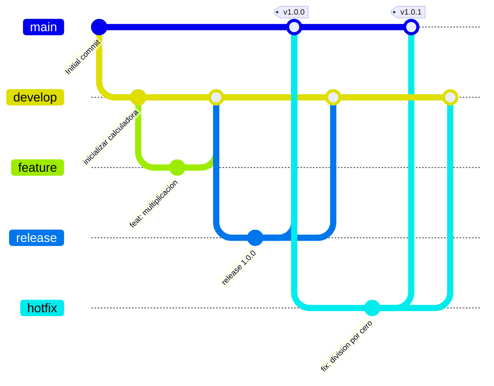

# iglesias-natali — Versionado con GitFlow

**Materia:** Prácticas Profesionalizantes I
**Alumna:** Natali Iglesias
**Tema:** Estrategia de ramificación (branching) con **GitFlow**

---

## ¿Qué es GitFlow?

**GitFlow** es una forma ordenada de organizar las ramas de un repositorio Git
para trabajar en equipo sobre un proyecto de software. Define dos ramas
principales y varias ramas temporales:

| Rama | Tipo | ¿Para qué sirve? |
|---|---|---|
| `main` | Permanente | Guarda el código **estable**, listo para producción. Cada versión publicada se etiqueta con un *tag*. |
| `develop` | Permanente | Es la rama de **integración**: todo lo nuevo se junta acá antes de salir a producción. |
| `feature/...` | Temporal | Una rama por **funcionalidad nueva**. Sale de `develop` y vuelve a `develop`. |
| `release/...` | Temporal | Prepara una **versión** para producción. Sale de `develop` y va a `main`. |
| `hotfix/...` | Temporal | Corrige un **error crítico** que ya está en producción. Sale de `main` y va a `main` y a `develop`. |

---

## Diagrama del flujo aplicado



---

## Pasos que realicé (con los comandos usados)

### 1. Rama `develop` a partir de `main`
```bash
git checkout main
git checkout -b develop
# Se crea la base del proyecto (calculadora.py, VERSION, CHANGELOG.md)
git add .
git commit -m "chore: inicializar el proyecto Calculadora en la rama develop"
```

### 2. Rama `feature` a partir de `develop` (nueva funcionalidad)
```bash
git checkout -b feature/multiplicacion
# Se agrega la función multiplicar()
git commit -am "feat: agregar función de multiplicación a la calculadora"
git checkout develop
git merge --no-ff feature/multiplicacion -m "merge: integrar feature/multiplicacion en develop"
```

### 3. Rama `release` a partir de `develop` (preparar versión de producción)
```bash
git checkout -b release/1.0.0
# Se actualiza VERSION a 1.0.0 y el CHANGELOG
git commit -am "chore(release): preparar versión 1.0.0 para producción"

git checkout main
git merge --no-ff release/1.0.0 -m "merge: publicar versión 1.0.0 en main"
git tag -a v1.0.0 -m "Versión 1.0.0 - primera versión estable"

# La versión también se devuelve a develop
git checkout develop
git merge --no-ff release/1.0.0 -m "merge: incorporar los cambios de la versión 1.0.0 a develop"
```

### 4. Rama `hotfix` a partir de `main` (corregir error crítico en producción)
```bash
git checkout main
git checkout -b hotfix/1.0.1
# Se corrige el error de división por cero en dividir()
git commit -am "fix: corregir error crítico al dividir por cero"

git checkout main
git merge --no-ff hotfix/1.0.1 -m "merge: publicar la corrección 1.0.1 en main"
git tag -a v1.0.1 -m "Versión 1.0.1 - corrección del error de división por cero"

# La corrección también se devuelve a develop
git checkout develop
git merge --no-ff hotfix/1.0.1 -m "merge: incorporar la corrección 1.0.1 a develop"
```

---

## Versiones (tags)

- **v1.0.0** → primera versión estable (calculadora con suma, resta, división y multiplicación).
- **v1.0.1** → corrección del error crítico de división por cero.

Para ver las versiones:
```bash
git tag
```

## Cómo ver el trabajo realizado

```bash
# Ver el historial completo con las ramas y merges
git log --oneline --graph --all --decorate
```

---

## Estructura del proyecto

```
iglesias-natali/
├── calculadora.py   # Código del proyecto (suma, resta, división y multiplicación)
├── VERSION          # Número de versión actual
├── CHANGELOG.md     # Historial de cambios
├── README.md        # Este archivo
└── LICENSE
```
